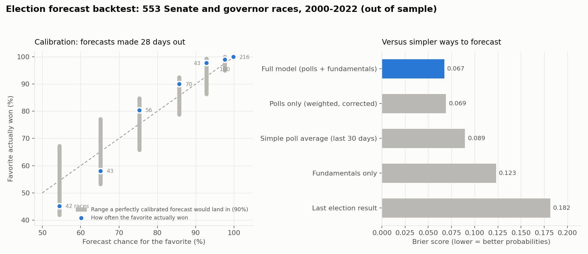

# Forecast Calibration & Baselines

*Generated by `src/calibration.py`. Rerun it to refresh.*

This report checks whether the forecast's probabilities mean what they say, and whether
the full model beats simpler ways of forecasting. Every polled Senate and governor race
from 2000 to 2022 was re-forecast as of 0 and 28 days before the election. Each cycle
was forecast using only other cycles' data: model coefficients, error sizes, pollster
ratings, and the generic-ballot correction. The national environment came from the
generic-ballot polls of the time, not the actual result.

## 1. Does the full model beat simpler methods?

**28 days out** (553 races, same horizon as a forecast published four weeks before election day):

| Method | RMSE (pts) | Winners right | Brier | Log loss |
|---|---|---|---|---|
| Full model (polls + fundamentals) | 6.58 | 89% | 0.067 | 0.214 |
| Polls only (weighted, corrected) | 6.91 | 90% | 0.069 | 0.222 |
| Simple poll average (last 30 days) | 7.20 | 91% | 0.089 | 0.304 |
| Fundamentals only | 12.44 | 82% | 0.123 | 0.390 |
| Last election result | 19.47 | 78% | 0.182 | 0.577 |

**Election eve:**

| Method | RMSE (pts) | Winners right | Brier | Log loss |
|---|---|---|---|---|
| Full model (polls + fundamentals) | 5.70 | 91% | 0.056 | 0.177 |
| Polls only (weighted, corrected) | 5.82 | 91% | 0.056 | 0.179 |
| Simple poll average (last 30 days) | 6.09 | 91% | 0.084 | 0.290 |
| Fundamentals only | 13.10 | 84% | 0.118 | 0.374 |
| Last election result | 19.12 | 79% | 0.172 | 0.547 |

Brier score and log loss measure probability quality (lower is better). They reward
being confident when right and punish being confident when wrong. The full model has
the best probabilities at both horizons. On picking winners it ties polls alone: the
fundamentals mostly sharpen margins and probabilities rather than flipping calls.

## 2. Calibration

When the model gave the favorite a given chance, how often did the favorite win?

**28 days out:**

| Forecast chance for favorite | Races | Avg forecast | Favorite actually won | Expected range if calibrated (90%) |
|---|---|---|---|---|
| 50-60% | 42 | 55% | 45% | 42-67% |
| 60-70% | 43 | 65% | 58% | 53-77% |
| 70-80% | 56 | 75% | 80% | 66-85% |
| 80-90% | 70 | 86% | 90% | 79-92% |
| 90-95% | 43 | 93% | 98% | 86-99% |
| 95-99% | 100 | 98% | 99% | 95-100% |
| 99%+ | 216 | 100% | 100% | 99-100% |

**Election eve:**

| Forecast chance for favorite | Races | Avg forecast | Favorite actually won | Expected range if calibrated (90%) |
|---|---|---|---|---|
| 50-60% | 43 | 56% | 44% | 43-68% |
| 60-70% | 47 | 65% | 64% | 54-77% |
| 70-80% | 35 | 75% | 77% | 63-87% |
| 80-90% | 50 | 86% | 94% | 78-94% |
| 90-95% | 46 | 92% | 96% | 86-99% |
| 95-99% | 82 | 98% | 100% | 95-100% |
| 99%+ | 325 | 100% | 100% | 100-100% |

- **28 days out:** all 7 buckets land inside their expected range.
- **On election eve:** all 7 buckets land inside their expected range.

Where the model misses calibration, it leans toward *under*confidence: favorites win a bit more often than forecast. That's the safer direction to be wrong in, and it means the uncertainty in the live forecast is, if anything, slightly too wide.

## 3. Generic-ballot correction

The generic congressional ballot sets the national environment for every race.
Historically its polling average has overstated Democrats:

| Days out | Cycles | Avg Dem overstatement (pts) | Cycles overstating Dems |
|---|---|---|---|
| 0 | 14 | 2.44 | 11 |
| 14 | 14 | 2.56 | 11 |
| 28 | 14 | 3.16 | 12 |
| 42 | 14 | 3.06 | 12 |

Removing that lean (estimated from other cycles only) improved the backtest at both
horizons, so the live forecast applies it. 2024 has no list of individual generic-ballot
polls, so national presidential polls vs. the popular vote stand in for that year.

**State and district polls** lean the same way, less strongly. In 2024 the Senate polls
overstated Democrats by about 2.5 points in 17 of 22 races. The forecast applies half of
the historical average lean, weighting recent cycles more, which is a correction of
1.8 pts at four weeks out. Tested with 2024 included, at four weeks out:

| State-poll correction | Margin RMSE | Brier | Log loss |
|---|---|---|---|
| None | 6.72 | 0.0673 | 0.2155 |
| Full | 6.68 | 0.0698 | 0.2200 |
| Half | 6.64 | 0.0677 | 0.2153 |
| Recent-weighted, full | 6.57 | 0.0695 | 0.2192 |
| **Recent-weighted, half (adopted)** | 6.58 | 0.0673 | 0.2144 |

Full-strength corrections over-correct and hurt the probabilities. The adopted version
ties on Brier, has the best log loss, cuts the margin error, and shrinks a 2024-style
miss from 4.4 to 3.0 points. Five variants were tried, so there is some risk of fitting
noise; the two half-strength versions agree.

## 4. Tested and not adopted

- **Full-strength pollster house-effect correction.** It was neutral in backtest (RMSE
  6.02 none / 6.03 half / 6.07 full), so corrections run at half strength.

## 5. Known limits

- Calibration covers Senate and governor races that had polls. Unpolled races are
  easier and would flatter the numbers, so they're excluded.
- Cycle-level effects (2016, 2020) mean the effective sample is about 12 election
  years, not 500 independent races. Chamber-control probabilities can't be calibrated
  directly from that few cycles.
- The House district model is checked separately: calibrated on 2024 and applied to
  2022 districts with unchanged lines, it called 94.6% of winners with ±5.7-point
  typical error.
